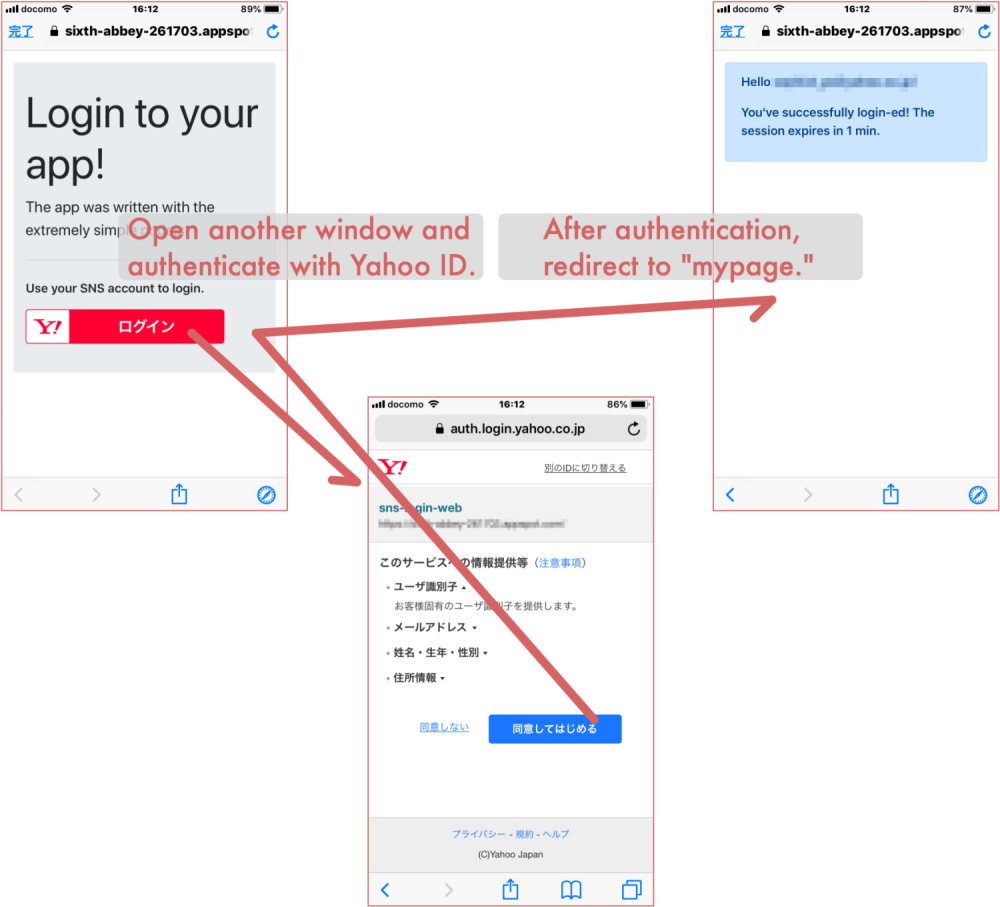
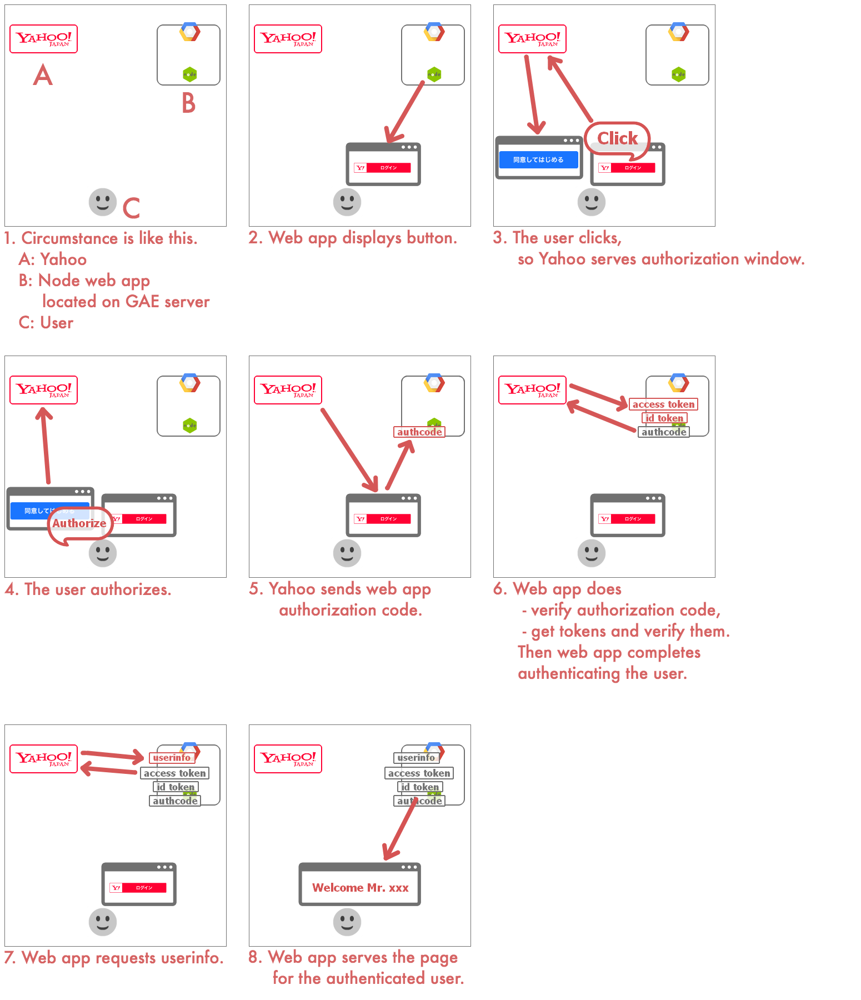

yahoo-login-web2
===

A small login authentication sample using Yahoo! ID 連携. Wanted to say "small" though it has became so complicated. It works on GCP - App Engine.



## Run with Docker

Only Docker (Docker Engine 25 or later with Compose v2.24 or later) is required; Node.js does not need to be installed on the host.

1. Create `.env` in the repository root (it is gitignored and excluded from the Docker build context):

   ```text
   YAHOO_CLIENT_ID=<your client id>
   YAHOO_CLIENT_SECRET=<your client secret>
   SESSION_MAX_AGE_MS=60000
   ```

2. Start the app and open http://localhost:3000/ (register `http://localhost:3000/inspection` as the callback URL of your Yahoo! ID 連携 application):

   ```bash
   docker compose up --build
   ```

   `APP_PORT=8080 docker compose up --build` changes the host port. Stop with `docker compose down`.

### Type check and tests

```bash
docker compose run --rm --build test
```

### Try the login flow offline with a mock Yahoo

`compose.mock.yaml` adds a local mock of the Yahoo endpoints and points the app at it with synthetic credentials (they override the credentials in `.env`), so no real Yahoo service is contacted:

```bash
docker compose -f compose.yaml -f compose.mock.yaml up --build --wait
docker compose -f compose.yaml -f compose.mock.yaml run --rm test node test/smoke/mocked-login.ts
docker compose -f compose.yaml -f compose.mock.yaml down
```

The smoke test opens the top page, calls `/inspection` with the synthetic authorization code (what Yahoo's redirect would deliver), then checks `/mypage`, `/test` and `/logout`. The Yahoo login button on the top page itself is loaded from Yahoo in the browser and is not part of the mock.

## Run without Docker

Node.js 24.12 or later (Node.js 26 LTS is recommended) is required. The server code is TypeScript and runs directly with Node.js' built-in type stripping, so there is no build step.

```bash
npm ci
npm start
```

The app listens on `PORT` (default `3000`).

## Environment variables

| Name | Required | Description |
|---|---|---|
| `YAHOO_CLIENT_ID` | yes | Client ID of your Yahoo! ID 連携 application. |
| `YAHOO_CLIENT_SECRET` | yes | Client secret of your Yahoo! ID 連携 application. |
| `SESSION_MAX_AGE_MS` | no | Session cookie lifetime in milliseconds. When unset, the cookie lasts for the browser session. |
| `PORT` | no | Listening port. Default `3000`. |
| `YAHOO_AUTH_ORIGIN` | no | Origin of the Yahoo authorization server. Default `https://auth.login.yahoo.co.jp`. Override only for local testing with a mock. |
| `YAHOO_USERINFO_ORIGIN` | no | Origin of the Yahoo UserInfo API. Default `https://userinfo.yahooapis.jp`. Override only for local testing with a mock. |

### env_variables.yaml (App Engine)

App Engine reads environment variables from env_variables.yaml, which `app.yaml` includes. Create it manually; it is gitignored so that credentials are never committed.

```yaml
# Not let git to include environment variables.
# Separate them from app.yaml and gitignore them.
env_variables:
  YAHOO_CLIENT_ID: '<your client id>'
  YAHOO_CLIENT_SECRET: '<your client secret>'
  SESSION_MAX_AGE_MS: 60000
```

## Development

```bash
npm run typecheck  # tsc (strict, no emit)
npm test           # node:test against a local mock of the Yahoo endpoints
npm run check      # both of the above (what `docker compose run --rm test` runs)
```

Tests never contact real Yahoo services; `test/support/mock-yahoo.ts` serves synthetic responses.

## Illustrate implemented authorization code grant flow

Below.


